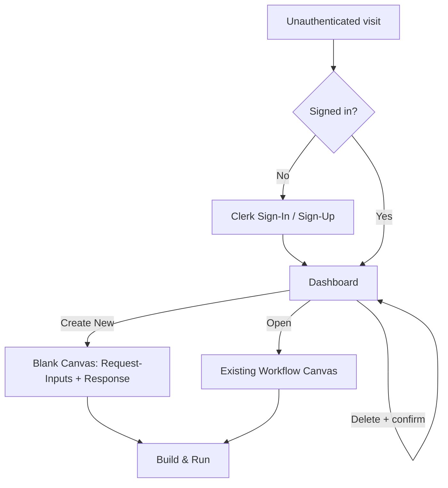
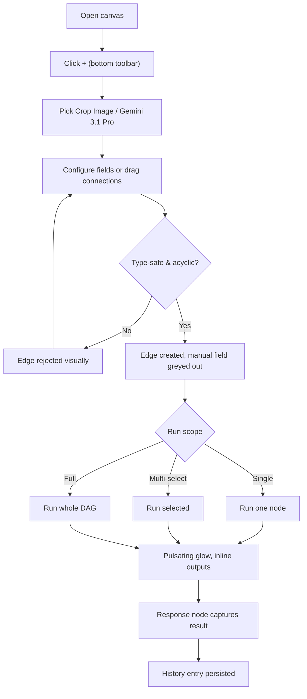
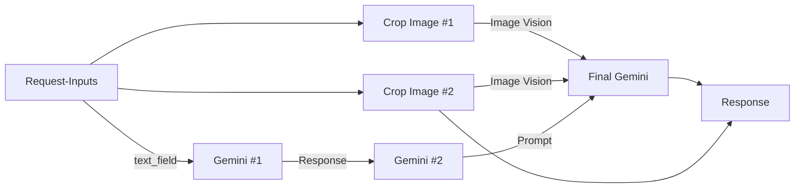
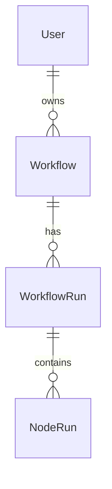

# Py — Pixel-Perfect Galaxy.ai Workflow Builder Clone

> **Single source of truth.** This document is the authoritative specification for this task.
> Read it before any implementation change and update it before/when requirements change.
> The screenshots in `images/` are visual reference material; this file is the written spec derived from them.

---

## Legend

- ✅ **Confirmed** — explicitly stated in the task screenshots.
- 🔎 **Inferred** — a reasonable conclusion not explicitly stated; implement unless contradicted.
- ❓ **Open question** — needs clarification or a provisional decision (see Section M).

Status markers (Sections J/L): ✔️ done & verified · 🟡 implemented, needs credentials to verify · ⬜ not started.

---

## Implementation Status (updated during build — 2026-10-16)

**Stack built:** Next.js 14 (App Router, TS strict) · React 18 · Tailwind · Prisma 5 (PostgreSQL) · Clerk v5 · `@xyflow/react` v12 · Zustand 5 · Zod 3 · `@google/generative-ai` · Trigger.dev v3 · Lucide.

**Verified locally (no external credentials):** `tsc --noEmit` clean · `next build` succeeds (12 routes) · **31 unit tests pass** (DAG timing, type-safety, zod, crop ≥30s, sample workflow) · runtime API smoke test (create/list/run/history) passes in demo mode.

**Key architectural decisions (provisional, documented):**
- **Graceful degradation / demo mode.** The app runs with zero credentials: Clerk off → middleware pass-through + `demo-user`; no `DATABASE_URL` → in-memory repository; no Gemini key → deterministic mock responses; no Transloadit → crop returns an annotated URL (still enforces the ≥30s delay). All real integrations are coded and activate when env vars are present.
- **Execution runs client-side for live UX** (staggered per-node pulsating glow + immediate fan-out via `lib/execution/engine.ts`), then persists the run via `POST /api/workflows/[id]/runs`. The same engine also powers the server-side `POST /api/workflows/[id]/run`. Trigger.dev task wrappers exist in `/trigger` (`crop-image`, `gemini-generate`); moving execution fully server-side onto Trigger.dev is the production path and only needs credentials. **The mandatory ≥30s crop delay is always enforced.**
- **Edge colors** follow the reference screenshot (blue=image, orange=text) — Open Q #1.

**Credentials status (2026-10-17):** Neon ✅ configured + `prisma db push` applied (persistence live) · Clerk ✅ keys in (real auth live) · Google AI ✅ key validated (model list fetched) — **default model set to `gemini-3.1-pro-preview`** (the account lacks `gemini-1.5-pro`; the node dropdown now lists real ids: `gemini-3.1-pro-preview`, `gemini-2.5-pro`, `gemini-2.5-flash`, `gemini-pro-latest`, `gemini-flash-latest`) · Transloadit ✅ key+secret in but **not yet wired** into upload/crop path · Trigger.dev ✅ keys in but execution **not yet dispatched** to hosted infra. Still pending: Transloadit + Trigger.dev wiring, and Vercel deploy. (Secrets live only in git-ignored `.env`; rotate before the repo goes public.)

**Run locally:** `npm install` → `npm run dev` → open `/dashboard` → "Sample" seeds the required workflow → "Run". `npm test` runs the suite.

**Source map:** `lib/` (types, nodes registry, dag, validation, store, execution engine/tasks, repo, sample-workflow) · `app/` (auth, dashboard, workflow/[id], api/*) · `components/canvas/*` + `components/dashboard/*` · `trigger/*` · `prisma/schema.prisma` + `seed.ts`.

---

## A. Task Overview

| Field | Detail |
| --- | --- |
| **Task name** | **Py** — a pixel-perfect clone of the Galaxy.ai workflow builder, focused exclusively on LLM workflows. |
| **Purpose** | Build a node-based visual workflow builder where a signed-in user composes, connects, and executes AI workflows on a canvas. |
| **Problem solved** | Lets users design multi-step AI pipelines (inputs → image/LLM processing → response) visually, run them (whole / partial / single node), and review run history — without writing code. |
| **Expected outcome** | A deployed Next.js app with Clerk auth, a dashboard of workflows, and a React Flow canvas that matches Galaxy.ai pixel-for-pixel, with real Trigger.dev-backed execution (Gemini + FFmpeg crop) and persisted history. |
| **Timeline** | ✅ 3 days. Ship a polished, working demo of the core flow; do not over-extend. |

### Scope — only these three pages. Nothing else. ✅

1. **Clerk Sign-In / Sign-Up** — auth entry point.
2. **Dashboard** — post-login landing page listing all of the signed-in user's workflows (name, last-edited timestamp, status). Supports create-new, open, rename, and delete.
3. **Workflow Canvas** — the main builder page (sidebar + canvas + history panel).

**Out of scope (do NOT build):** ✅ marketing page, landing page, pricing page, or any public-facing surface. Unauthenticated traffic is redirected straight to Clerk.

### Reference (source of truth for UI/UX) ✅

- Reference product: Galaxy.ai — `try.galaxy.ai/clone` → **Clone Workflow** gives full access to canvas, sidebar, node UI, history panel, and animations (no run credits needed).
- Running workflow reference video: `https://drive.google.com/file/d/14D2052n6b3IfMRHYxavDbOaRP0vj6FR8/view?usp=drive_link`
- **Match pixel-perfect — do not deviate.** Anything not explicitly listed here should mirror the Galaxy.ai reference exactly (spacing, fonts, colors, hover states, animations, scroll behavior, edge styling, MiniMap, dot grid, etc.).

---

## B. Screenshot References

All images live in `./images/`. Screenshots 01–12 are pages of the task brief (text requirements); screenshot 13 is the required sample-workflow canvas layout.

| # | File | Represents |
| --- | --- | --- |
| 01 | [screenshot-01-project-overview-reference.png](./images/screenshot-01-project-overview-reference.png) | Project Overview + scope (3 pages) + "Your Reference" (Galaxy.ai is source of truth). |
| 02 | [screenshot-02-timeline-note.png](./images/screenshot-02-timeline-note.png) | Timeline (3 days) + Note to Applicants. |
| 03 | [screenshot-03-functional-requirements-nodes.png](./images/screenshot-03-functional-requirements-nodes.png) | Functional Requirements: adding nodes (bottom + picker), node types 1 (Request-Inputs) & 2 (Crop Image). |
| 04 | [screenshot-04-node-types-auth-dashboard.png](./images/screenshot-04-node-types-auth-dashboard.png) | Node types 3 (Gemini 3.1 Pro) & 4 (Response), **mandatory 30s+ delay on Crop**, Authentication, Dashboard Page. |
| 05 | [screenshot-05-llm-integration.png](./images/screenshot-05-llm-integration.png) | LLM Integration (Gemini provider, Trigger.dev execution, vision, models, result display). |
| 06 | [screenshot-06-workflow-features-history.png](./images/screenshot-06-workflow-features-history.png) | Workflow Features list + Workflow History (right sidebar). |
| 07 | [screenshot-07-history-example-tech-stack.png](./images/screenshot-07-history-example-tech-stack.png) | Example expanded history view + required Tech Stack. |
| 08 | [screenshot-08-triggerdev-rule-sample-workflow.png](./images/screenshot-08-triggerdev-rule-sample-workflow.png) | Trigger.dev rule (+ `[Py] Candidate LinkedIn:` console.log) + "Required Sample Workflow" intro. |
| 09 | [screenshot-09-sample-nodes-table-part1.png](./images/screenshot-09-sample-nodes-table-part1.png) | Sample workflow Nodes table, rows 1–4 (Request-Inputs, Crop #1, Crop #2, Gemini #1). |
| 10 | [screenshot-10-sample-nodes-table-part2.png](./images/screenshot-10-sample-nodes-table-part2.png) | Sample workflow Nodes table, rows 4–7 (Gemini #1 prompt, Gemini #2, Final Gemini, Response). |
| 11 | [screenshot-11-execution-behavior-deliverables.png](./images/screenshot-11-execution-behavior-deliverables.png) | Expected execution behavior (DAG fan-out) + Deliverables (start). |
| 12 | [screenshot-12-deliverables-checklist-api-keys.png](./images/screenshot-12-deliverables-checklist-api-keys.png) | Deliverables checklist (full) + API Keys/providers. |
| 13 | [screenshot-13-reference-canvas-layout.png](./images/screenshot-13-reference-canvas-layout.png) | **Required sample workflow** canvas layout, node placement, and edge routing to replicate. |

**Relationships:** 01–02 set scope & context. 03–07 define features. 08–11 define the exact sample workflow to pre-build + its runtime behavior. 12 lists acceptance deliverables + credentials. 13 is the visual target for the sample workflow.

---

## C. Requirements Identified from Screenshots

### C.1 Global / App Shell
- Three routes only: Clerk auth, Dashboard, Workflow Canvas. ✅
- All workflow routes protected; unauthenticated users redirected to Clerk. ✅
- 🔎 Dark/light theme should mirror Galaxy.ai (reference shows a **light** theme with white node cards on a light dotted canvas).
- On the **initial client render of every page**, emit exactly one `console.log` in the **exact** format: ✅
  `[Py] Candidate LinkedIn: https://www.linkedin.com/in/abodh-shah/` — for build attribution.
  - Confirmed URL: `https://www.linkedin.com/in/abodh-shah/` (provided by candidate, 2026-10-16).
  - "Every page" = all three routes (auth, dashboard, canvas). 🔎 Log fires once per full page load on the client (not on client-side route transitions).

### C.2 Clerk Sign-In / Sign-Up
- Auth entry point using Clerk. ✅
- 🔎 Standard Clerk `<SignIn/>` / `<SignUp/>` components; styling to match Galaxy.ai where feasible.

### C.3 Dashboard Page ✅
- Lists all workflows belonging to the signed-in user: **name**, **last-edited timestamp**, **status badge** if a run is in progress.
- **Create New Workflow** button → opens a blank canvas.
- Per-row actions: **Open**, **Rename**, **Delete**.
- **Empty state** when the user has no workflows yet.
- Match Galaxy.ai dashboard styling (same sidebar, same card/list pattern).

### C.4 Workflow Canvas — Layout (from screenshot 13) ✅
- **Top bar:** back arrow `←` + editable workflow title ("Trial Task Workflow"); right side shows estimate (`Est 0.01 M`), balance (`Bal 5085.54 M`), a primary **Run** button (purple), and a **history** (clock) icon toggle.
- **Canvas:** dot-grid background, pan/zoom/fit-view, nodes as white rounded cards with subtle shadow.
- **Bottom-left:** collapse/expand arrow (`>`) — 🔎 toggles left panel.
- **Bottom-center floating toolbar:** a duplicate/file icon + the **`+`** button (opens the node picker).
- **Bottom-right:** **MiniMap** toggle icon.
- **Edges:** animated; **blue** edges for image connections, **orange/amber** edges for text connections. 🔎 (Brief calls them "animated purple edges"; reference screenshot shows blue+orange by handle type. Treat edge color as type-driven to match the reference — see Open Questions.)
- **Right sidebar:** Workflow History panel (toggled by the clock icon).

### C.5 Node cards (common) ✅
- Header: node type label + icon, plus controls: duplicate, delete (menu/button), a green **Run** button (run this node), and a `...` overflow menu.
- Each input parameter row: a **handle** (colored dot) on the left, a label, and a field (text/slider/upload) or `+` to add.
- Output section at the bottom ("No output yet" placeholder) with an output handle.
- **Pulsating glow** on any node currently executing. ✅

### C.6 The 4 node types ✅

**1. Request-Inputs** (pre-placed, top-left, non-deletable)
- Single node with a `+` to add configurable fields.
- Field types: `text_field` (textarea) and `image_field` (Transloadit upload; jpg/jpeg/png/webp/gif, with preview).
- Each field exposes its **own output handle** so it can be wired downstream.
- User can rename fields and add as many as needed (e.g. `text_field`, `image_field`, `image_field_2`).

**2. Crop Image** (added via `+` picker)
- Inputs: **Input Image** (required) + **X Position (%)**, **Y Position (%)**, **Width (%)**, **Height (%)** (0–100; defaults 0/0/100/100).
- Executed via **FFmpeg on Trigger.dev**.
- Output: **Output Image** (cropped image URL).
- ⚠️ **MANDATORY:** the Crop Image Trigger.dev task **must `await` at least 30 seconds** before returning. Hard requirement — do not skip. ✅

**3. Gemini 3.1 Pro** (added via `+` picker — LLM)
- Model selector in node header.
- Inputs: **Prompt** (required), **System Prompt**, **Image (Vision)**, **Video**, **Audio**, **File**, plus a collapsed **Settings** section.
- Output: **Response** (text), rendered **inline on the node**.

**4. Response** (pre-placed, right, non-deletable)
- Single `result` input handle. Collects the final workflow output(s) for display/export. **No output handle.**
- 🔎 The `result` handle **accepts multiple incoming connections** (sample workflow row 7 wires both Final Gemini.`Response` and Crop Image #2 output into it). It therefore aggregates/displays a list of collected outputs, each labelled by source node (reference screenshot 13 shows `gemini_3_1_pro` and `crop_image` rows inside the Response node).

### C.7 Node picker (`+` button) ✅
- Opens a **searchable** picker with categories: **Recent, Image, Video, Audio, Others**.
- For this trial only **Crop Image** and **Gemini 3.1 Pro** need to be functional — match the picker UI/UX of the live reference.

### C.8 Workflow Features ✅
- Add nodes via bottom `+` picker (Crop Image, Gemini 3.1 Pro). Request-Inputs & Response pre-placed and not deletable.
- Animated edges between handles.
- **Configurable inputs:** every parameter accepts a connection **OR** manual entry. When a handle is connected, the manual field is **greyed out / disabled**.
- **Type-safe connections:** image outputs cannot connect to text inputs, etc. Invalid drags are visually rejected.
- **DAG-only:** cycles disallowed.
- **Delete:** menu button + Delete/Backspace keyboard (Request-Inputs & Response exempt).
- **Canvas:** pan, zoom, fit-view, MiniMap (bottom-right), dot-grid background.
- **Undo/Redo** for node operations.
- **Selective execution:** run a single node, a multi-select, or the whole workflow. Each creates a history entry.
- **Parallel execution:** independent nodes trigger concurrently; a finished node fans out to its dependents **immediately** — it must never block on unrelated siblings at the same DAG level.
- **Pulsating glow** on every node currently executing.
- **Persistence:** workflows + history saved to PostgreSQL.
- **Export/Import** workflows as JSON.

### C.9 Workflow History (right sidebar) ✅
- List of all runs: timestamp, status (success / failed / partial), duration, scope (full / partial / single).
- Color-coded badges: green / red / yellow.
- Click a run → expand to **node-level details**: per-node status, inputs used, output, execution time, error if failed.
- Persisted to PostgreSQL.
- **Example expanded view** (screenshot 07):
  ```
  Run #123 — Apr 25, 2026 3:45 PM (Full Workflow)
  ├── Request-Inputs  ✅ 0.1s  → text_field, image_field
  ├── Crop Image #1   ✅ 31.8s → https://cdn.transloadit.com/...
  ├── Crop Image #2   ✅ 32.1s → https://cdn.transloadit.com/...
  ├── Gemini #1       ✅ 4.2s  → "Introducing our premium..."
  ├── Gemini #2       ✅ 3.9s  → "Silence the world. 30 hrs..."
  ├── Final Gemini    ✅ 4.5s  → "Hear what matters..."
  └── Response        ✅ 0.1s  → final result captured
  ```

---

## D. Functional Requirements (behavior)

### D.1 Adding a node
- **User action:** click bottom-center `+` → searchable picker opens with categories.
- **Response:** selecting Crop Image / Gemini 3.1 Pro inserts the node onto the canvas; it becomes draggable, connectable, and runnable.
- **Validation:** only Crop Image & Gemini need to function; others may appear but need not execute.

### D.2 Connecting handles
- **User action:** drag from an output handle to an input handle.
- **Response:** animated edge created; the target manual field is greyed out/disabled while connected.
- **Validation:** type-safe — image→image, text→text, etc. Invalid drags visually rejected. Cycles disallowed (DAG-only).
- **Failure:** dropping on an incompatible handle shows rejection (no edge created).

### D.3 Configurable input (connection OR manual)
- **User action:** either type a value or wire a connection.
- **Response:** if connected, manual field disabled and value flows from upstream; if not, manual value is used.

### D.4 Running nodes
- **Single run:** green Run on a node → executes just that node (using current/available inputs) → creates a `single` history entry.
- **Multi-select run:** select multiple nodes → run → executes only targeted nodes → `partial` history entry.
- **Full run:** top-bar Run → executes whole DAG → `full` history entry.
- **Response:** pulsating glow on each executing node; outputs render inline (Gemini) / as image (Crop); Response node collects final result.
- **Execution semantics:** executable nodes (Gemini, Crop Image) run as **Trigger.dev tasks**. Request-Inputs & Response are **local-only** (resolve values / capture result; no Trigger.dev task). Independent tasks fire concurrently; each task awaits only its **direct upstream** dependencies.
- **Failure:** node shows failed state; history records error; downstream dependents do not run (🔎 or run with missing input — see Open Questions).

### D.5 Delete node
- **User action:** node menu delete button, or select + Delete/Backspace.
- **Response:** node + its edges removed (undoable).
- **Exempt:** Request-Inputs and Response cannot be deleted.

### D.6 Undo/Redo
- **User action:** keyboard (Ctrl/Cmd+Z, Ctrl/Cmd+Shift+Z) 🔎 and/or UI.
- **Response:** reverses/replays node operations (add, delete, move, connect, edit).

### D.7 Export / Import
- **Export:** serialize the workflow (nodes, edges, field config) to JSON file download.
- **Import:** load a JSON file → reconstruct the workflow on canvas (validated with Zod).

### D.8 Duplicate node 🔎
- **User action:** click the duplicate icon in a node header (visible in screenshot 13).
- **Response:** a copy of the node (with its field config, minus edges) is placed with a slight offset; it is independently connectable/runnable.
- 🔎 Request-Inputs and Response are 🔎 not duplicable (singletons); confirm in Open Questions.

### D.9 Dashboard actions
- **Create New Workflow** → new blank canvas (Request-Inputs + Response pre-placed) → navigate to canvas.
- **Open** → navigate to that workflow's canvas.
- **Rename** → inline/dialog edit of workflow name → persist.
- **Delete** → remove workflow (🔎 with confirm) → persist.
- **Status badge** shows when a run is in progress.

---

## E. Missing Requirements & Gap Analysis

| # | Missing / Unclear | Why it matters | Proposed solution / assumption | Clarify? |
| --- | --- | --- | --- | --- |
| 1 | **Edge color**: brief says "animated purple edges"; reference screenshot shows blue (image) + orange (text). | Pixel-perfect grading. | 🔎 Follow the **reference screenshot** (type-colored edges) since "match pixel-perfect" overrides prose. Keep animation. | Yes |
| 2 | **"M" units / balance / estimate** in top bar (`Est 0.01 M`, `Bal 5085.54 M`). | Appears in reference UI. | 🔎 Render as cosmetic/static UI to match visuals; no billing backend. | Yes |
| 3 | **Downstream behavior on node failure.** | Determines partial-run semantics. | 🔎 Mark dependents as skipped/blocked; record `partial`/`failed`. | Yes |
| 4 | **Transloadit vs Trigger.dev FFmpeg** for crop (history example shows `cdn.transloadit.com`). | Output URL source. | 🔎 Upload via Transloadit, crop via FFmpeg-on-Trigger.dev, store resulting URL. | Yes |
| 5 | **Gemini model list** beyond default `Gemini 3.1 Pro`. | Model selector contents. | ✅ RESOLVED — account exposes `gemini-3.1-pro-preview` (= "Gemini 3.1 Pro"); default set to it; dropdown lists real ids. `gemini-1.5-pro` is NOT available on this key. | No |
| 6 | **Auth scoping details** (orgs vs personal). | Data isolation. | 🔎 Scope workflows + history to the authenticated Clerk user id. | No |
| 7 | **Autosave vs explicit save** on canvas. | Persistence UX. | 🔎 Debounced autosave of workflow graph to PostgreSQL. | Yes |
| 8 | **Concurrency / rate limits** for parallel Gemini calls (free tier). | Reliability. | 🔎 Rely on Trigger.dev queueing; handle 429 with retry/backoff. | Yes |
| 9 | **Accessibility & keyboard** specifics. | Quality. | 🔎 Provide focus states, aria labels on controls, keyboard delete/undo. | No |
| 10 | **Responsive design** for canvas. | Usability. | 🔎 Desktop-first (builder UX); gracefully degrade; not a primary grading axis. | No |
| 11 | **LinkedIn URL** for the required console.log. | Hard requirement content. | ✅ **RESOLVED** — `https://www.linkedin.com/in/abodh-shah/`. | No |
| 12 | **Image (Vision) multi-connect** — handle accepts multiple connections. | Final Gemini needs 2 image inputs. | ✅ Supported per brief; implement multi-edge target handle for Vision. | No |
| 13 | **Response `result` multi-connect** — collects more than one output. | Sample row 7 wires 2 outputs into Response. | 🔎 Make `result` a multi-incoming handle; aggregate + label by source node. | No |
| 14 | **Node duplication** — duplicate icon in node header. | Shown in reference; expected parity. | 🔎 Implement duplicate for Crop/Gemini; singletons (Request-Inputs, Response) not duplicable. | Yes |
| 15 | **Workflow title editing** on canvas top bar. | Title looks editable in screenshot 13. | 🔎 Inline-edit title → autosave; mirrors dashboard rename. | No |
| 16 | **Initial fit-view / default viewport** when opening a workflow. | Usability on load. | 🔎 `fitView` on mount so the whole graph is visible. | No |
| 17 | **Mandatory `console.log` scope** — "every page", once. | Hard requirement; avoid duplicate/missing logs. | 🔎 Fire once per full client load on each of the 3 routes. | Yes |

Essential inferred requirements: #1, #3, #4, #6, #7, #12, #13. Optional improvements: #9, #10, #14, #15, #16.

---

## F. User Flows

### F.1 Auth → Dashboard → Canvas


### F.2 Build + run a workflow


### F.3 Sample-workflow DAG execution (required behavior) ✅

- Crop #1, Crop #2, and Gemini #1 all start at **T=0** (same DAG level, concurrent fan-out). ✅
- Gemini #2 starts as soon as Gemini #1 finishes — must **not** wait for the Crops. ✅
- Final Gemini starts only once **all** upstream deps (both Crops + Gemini #2) complete. ✅
- Single-node and multi-select runs execute only the targeted nodes. ✅

---

## G. Data & API Requirements

> All schemas/endpoints below are **proposed designs requiring validation** (🔎), not verified existing contracts.

### G.1 Entities (proposed Prisma models)
- **User** — mirror/reference Clerk user id (workflows + history scoped to it). ✅ scoping requirement.
- **Workflow** — `id`, `userId`, `name`, `graph` (JSON: nodes+edges+field config), `status`, `createdAt`, `updatedAt` (last-edited). ✅ fields from dashboard.
- **Run (WorkflowRun)** — `id`, `workflowId`, `scope` (full|partial|single), `status` (success|failed|partial), `startedAt`, `durationMs`, `createdAt`.
- **NodeRun** — `id`, `runId`, `nodeId`, `nodeType`, `status`, `inputs` (JSON), `output` (JSON/text/url), `durationMs`, `error`.



### G.2 API operations (proposed, App Router route handlers + Zod)
| Operation | Method/Route (proposed) | Notes |
| --- | --- | --- |
| List workflows | `GET /api/workflows` | Scoped to Clerk user. |
| Create workflow | `POST /api/workflows` | Seeds Request-Inputs + Response. |
| Get workflow | `GET /api/workflows/:id` | |
| Update (save/rename) | `PATCH /api/workflows/:id` | Autosave graph + name. |
| Delete workflow | `DELETE /api/workflows/:id` | |
| Trigger run | `POST /api/workflows/:id/run` | body: scope + target node ids; kicks Trigger.dev tasks. |
| List runs | `GET /api/workflows/:id/runs` | History panel. |
| Get run detail | `GET /api/runs/:id` | Node-level expand. |
| Export | `GET /api/workflows/:id/export` | JSON download. |
| Import | `POST /api/workflows/import` | Zod-validated JSON. |

### G.3 Trigger.dev tasks (proposed)
- `crop-image` task — inputs: image URL + x/y/w/h %; **awaits ≥30s**; runs FFmpeg; returns cropped image URL. ✅ delay.
- `gemini-generate` task — inputs: prompt, system prompt, optional vision images/video/audio/file, settings; calls `@google/generative-ai`; returns text. ✅
- Request-Inputs & Response are local-only (no task). ✅
- Independent tasks fire concurrently; each awaits only direct upstream deps. ✅

### G.4 Loading / error handling
- Node-level states: idle, running (pulsating glow), success (inline output), failed (error shown + in history). ✅
- History persists per-node inputs, output, duration, error. ✅
- 🔎 Retry/backoff on Gemini 429 (free tier).

---

## H. UI & Design Guidelines

- **Design source of truth:** Galaxy.ai reference (clone it and match spacing, fonts, colors, hover states, animations, scroll, edge styling, MiniMap, dot grid). ✅
- **Layout:** top bar (title + run/history) · canvas (dot grid, nodes, MiniMap bottom-right, `+` toolbar bottom-center, panel toggle bottom-left) · right history sidebar. ✅ (screenshot 13)
- **Nodes:** white rounded cards, subtle shadow, header with type label + controls (duplicate, delete, green Run, `...`), colored input handles on the left, output section at bottom. ✅
- **Edges:** animated; type-colored (blue = image, orange = text) per reference. 🔎
- **States:** pulsating glow while running; greyed-out manual fields when a handle is connected; empty states (dashboard "no workflows", node "No output yet"). ✅
- **Icons:** Lucide React. ✅ (tech stack)
- **Styling:** Tailwind. ✅
- **Reusable components:** node shell, handle, parameter row (text/slider/upload), history row, run badge, node picker.
- **Accessibility:** 🔎 focus rings, aria labels, keyboard delete/undo, sufficient contrast.
- **Responsive:** 🔎 desktop-first builder; graceful degradation.

---

## I. Technical Implementation Plan

### I.0 Current project state (verified)
- Project directory `d:\magica-assignment` contains only `task.md` and `images/`. **No code scaffold yet.** No git repo detected (`git` not on PATH in this shell). Greenfield build.

### I.1 Required tech stack ✅
Next.js (App Router) · TypeScript (**strict**) · PostgreSQL (**Neon**) · **Prisma** · **Clerk** · **React Flow** · **Trigger.dev** · **Transloadit** · **FFmpeg (via Trigger.dev)** · **Tailwind** · **Zustand** · **Zod** · `@google/generative-ai` · **Lucide React**. Deploy on **Vercel**. ✅

### I.2 Proposed structure (new files)
```
app/
  (auth)/sign-in, sign-up        # Clerk
  dashboard/                     # workflow list
  workflow/[id]/                 # canvas page
  api/workflows/...              # route handlers (Zod)
components/
  canvas/ (ReactFlow wrapper, nodes/, edges/, MiniMap, toolbar, picker)
  history/ (panel, run row, node detail)
  dashboard/ (list, card, create/rename/delete dialogs)
lib/
  store/ (Zustand graph + run state)
  db/ (Prisma client)
  gemini.ts, transloadit.ts, dag.ts (toposort/validation)
trigger/
  crop-image.ts (≥30s await + FFmpeg)
  gemini-generate.ts
prisma/schema.prisma
```

### I.3 Integration points & risks
- **DAG executor** honoring immediate fan-out + direct-dependency-only waits (core grading criterion). ✅
- **Type-safe + acyclic** connection validation (Zustand + React Flow `isValidConnection`). ✅
- **Trigger.dev** orchestration of concurrent tasks with per-node history writes. ✅
- **Transloadit upload** + **FFmpeg crop** returning a usable URL (+ mandatory 30s delay). ✅
- **Gemini vision multi-image** input on Final Gemini. ✅
- **Pixel-perfect** matching of Galaxy.ai (highest-effort, subjective). ✅
- **`[Py] Candidate LinkedIn: https://www.linkedin.com/in/abodh-shah/` console.log** on initial client render of every page. ✅

---

## J. Acceptance Criteria (testable checklist)

Derived from the Deliverables checklist (screenshots 11–12). Mark complete only when implemented + verified.

- 🟡 Pixel-perfect clone of the Galaxy.ai workflow builder — built close to the reference; live side-by-side pixel diff still pending (needs reference access). ✅
- 🟡 Clerk auth + protected routes (sign-in/up only — no marketing/home page) — coded + middleware; verified in demo fallback, real Clerk needs keys. ✅
- ✔️ Dashboard listing user's workflows (open / rename / delete / create-new) + empty state. ✅
- ✔️ Canvas opens with Request-Inputs + Response pre-placed; Crop Image & Gemini 3.1 Pro added via bottom `+` picker. ✅
- ✔️ Right-sidebar workflow history with node-level expand. ✅
- ✔️ React Flow canvas: dot grid, MiniMap, pan/zoom/fit-view, undo/redo. ✅
- 🟡 All node executions via Trigger.dev tasks — task wrappers in `/trigger`; app currently runs the same logic via the engine (client live-run + server `/run`), switches to hosted Trigger.dev with keys. ✅
- ✔️ Crop Image: 30+ second artificial delay (mandatory) — enforced; unit-tested. ✅
- ✔️ Pulsating glow on running nodes. ✅
- ✔️ Parallel siblings pulsate simultaneously; first-to-finish proceeds without blocking on others — unit-tested (DAG timing). ✅
- ✔️ Type-safe connections + connected-input greyed-out state + DAG validation — unit-tested. ✅
- ✔️ Selective execution (single / multi-select / full) — unit-tested. ✅
- ✔️ Pre-built sample workflow as specified (Section K / screenshots 09–13). ✅
- 🟡 Gemini integration with vision — code path builds inline image parts; real calls need a Google AI key (mock otherwise). ✅
- ✔️ Animated edges (color per reference — Open Q #1). ✅
- ✔️ API routes with Zod validation — smoke-tested. ✅
- 🟡 PostgreSQL via Prisma; workflows + history persisted — schema + Prisma repo done; in-memory fallback for demo; needs Neon to verify. ✅
- ✔️ Workflow export/import as JSON (Zod-validated). ✅
- ✔️ TypeScript strict mode — `tsc --noEmit` clean. ✅
- ⬜ Deployed on Vercel — pending credentials. ✅
- ✔️ `[Py] Candidate LinkedIn: https://www.linkedin.com/in/abodh-shah/` logged once on initial client render of every page. ✅
- ✔️ Response node aggregates multiple collected outputs, labelled by source node — unit-tested. 🔎
- ✔️ Node duplication works for Crop/Gemini; Request-Inputs & Response are not deletable/duplicable singletons. 🔎
- ✔️ Canvas opens with `fitView`; workflow title is inline-editable + autosaved. 🔎

---

## K. Required Sample Workflow (pre-build this exact workflow) ✅

Match the layout, node placement, and edge routing of **screenshot 13**.

| # | Type | Config / Wiring |
| --- | --- | --- |
| 1 | **Request-Inputs** | Two fields: `text_field` = *"Product: Wireless Bluetooth Headphones. Features: Noise cancellation, 30-hour battery, foldable design."* and `image_field` = uploaded product photo. |
| 2 | **Crop Image #1** | x=20, y=20, w=60, h=60 (tight product crop). Input Image ← Request-Inputs.`image_field`. |
| 3 | **Crop Image #2** | x=0, y=0, w=100, h=50 (wide banner crop). Input Image ← Request-Inputs.`image_field`. |
| 4 | **Gemini 3.1 Pro #1** | System Prompt: *"You are a marketing copywriter. Write a one-paragraph product description."* — Prompt ← Request-Inputs.`text_field`. |
| 5 | **Gemini 3.1 Pro #2** | System Prompt: *"Condense the following product description into a tweet-length hook (under 240 characters)."* — Prompt ← Gemini #1.`Response`. |
| 6 | **Gemini 3.1 Pro #3 (Final)** | System Prompt: *"You are a social media manager. Combine the tweet hook and the two product crops into a final marketing post."* — Prompt ← Gemini #2.`Response`; Image (Vision) ← Crop #1 + Crop #2. |
| 7 | **Response** | `result` ← Final Gemini.`Response` and Crop Image #2 output. |

**Expected execution behavior** (see F.3): concurrent fan-out of Crop #1 / Crop #2 / Gemini #1 at T=0; Gemini #2 right after Gemini #1 (no wait on crops); Final Gemini only after both crops + Gemini #2; single/multi-select runs execute only targeted nodes. ✅

---

## L. Implementation Checklist (phased — all PENDING)

- [x] **Phase 0 — Scaffold:** Next.js (App Router, TS strict), Tailwind, Prisma+Neon, Clerk, Zustand, Zod, React Flow, Trigger.dev, Lucide. `[Py] Candidate LinkedIn: …` client log added.
- [x] **Phase 1 — Auth & shell:** Clerk sign-in/up, middleware route protection, redirect unauth → Clerk (demo fallback when keys absent).
- [x] **Phase 2 — Dashboard:** list/create/open/rename/delete, empty state, status badge, import, sample, persistence.
- [x] **Phase 3 — Canvas UI:** React Flow (dot grid, MiniMap, pan/zoom/fit-view), top bar, bottom `+` toolbar, node picker, pre-placed Request-Inputs + Response.
- [x] **Phase 4 — Node UIs:** Request-Inputs (add/rename fields, per-field handles), Crop Image (sliders), Gemini 3.1 Pro (inline response, model select, settings), Response (aggregation).
- [x] **Phase 5 — Connections:** type-safe + acyclic validation, greyed-out connected fields, animated type-colored edges, delete/duplicate/undo/redo, singleton protection.
- [x] **Phase 6 — Execution:** engine (concurrent fan-out, direct-dep waits), crop ≥30s, single/multi/full runs, pulsating glow; Trigger.dev task wrappers + Transloadit/Gemini integration points (local+mock fallback).
- [x] **Phase 7 — History:** right sidebar, run list w/ color badges, node-level expand, persistence (Prisma + in-memory fallback).
- [x] **Phase 8 — Export/Import:** JSON out/in with Zod validation.
- [x] **Phase 9 — Sample workflow:** Section K pre-built (`lib/sample-workflow.ts`), laid out per screenshot 13; seed script + dashboard action.
- [x] **Phase 10 — Tests:** 31 unit tests (DAG timing, type-safety, zod, crop delay, sample workflow) + typecheck + build + API smoke.
- [ ] **Phase 11 — Polish & deploy:** live pixel-perfect pass vs Galaxy.ai + reference video; a11y/responsive polish; **Vercel deploy with user-provided credentials** (pending Open Q #8).

---

## M. Testing Plan

Adapt to the scaffolded tooling once Phase 0 lands. Proposed stack (🔎): **Vitest** (unit), **React Testing Library** (component), **Playwright** (E2E).

### M.1 Unit tests
- `dag.ts`: topological sort; cycle detection rejects back-edges; direct-dependency resolution; level grouping for fan-out.
- Connection type-safety: image→image allowed, image→text rejected, text→text allowed; multi-connect allowed for Vision + Response `result`.
- Zod schemas: workflow import/export round-trip; invalid JSON rejected.
- Crop task: asserts it awaits ≥30s (use fake timers) and returns a URL.

### M.2 Component / integration tests
- Node render: Request-Inputs add/rename field + per-field output handle; Crop sliders clamp 0–100; Gemini inline Response render; Response aggregates multiple inputs.
- Connected input becomes greyed-out/disabled; disconnect re-enables manual entry.
- Node picker: search + categories; inserts Crop/Gemini.
- Delete/duplicate: Request-Inputs & Response exempt from delete; duplicate offsets a copy.
- Undo/redo across add/delete/move/connect/edit.
- Each page logs `[Py] Candidate LinkedIn: https://www.linkedin.com/in/abodh-shah/` exactly once on initial client render.

### M.3 End-to-end tests
- Auth gate: unauthenticated → Clerk; authenticated → dashboard.
- Dashboard: create → open → rename → delete; empty state.
- Build + full run of the sample workflow; assert DAG timing (Crop#1/Crop#2/Gemini#1 concurrent at T=0; Gemini#2 right after Gemini#1; Final Gemini only after both crops + Gemini#2).
- Single-node and multi-select runs execute only targeted nodes.
- History entry created per run; node-level expand shows status/inputs/output/duration/errors.
- Export → re-import reproduces the graph.

### M.4 Manual verification
- Pixel-perfect diff against Galaxy.ai (spacing, fonts, colors, hover, animations, edge colors, MiniMap, dot grid) + the reference video.
- Pulsating glow on running nodes; parallel siblings glow simultaneously.
- Vercel production smoke test with real credentials.

> Testing is **optional-but-encouraged** given the 3-day timeline; prioritize E2E of the sample workflow + DAG timing, which are the core grading criteria.

---

## N. Open Questions & Decisions

| # | Question | Provisional decision | Status |
| --- | --- | --- | --- |
| 1 | Edge color: "purple" (prose) vs blue/orange (reference)? | Follow reference screenshot (type-colored). | ❓ confirm |
| 2 | Are top-bar `Est`/`Bal` real billing or cosmetic? | Cosmetic to match visuals. | ❓ confirm |
| 3 | Downstream behavior when a node fails? | Skip/block dependents; record partial/failed. | ❓ confirm |
| 4 | Crop output: Transloadit CDN vs Trigger FFmpeg output? | Upload via Transloadit, crop via FFmpeg task, store URL. | ❓ confirm |
| 5 | Save model: autosave vs explicit? | Debounced autosave. | ❓ confirm |
| 6 | **LinkedIn profile URL** for mandatory console.log? | `https://www.linkedin.com/in/abodh-shah/`. | ✅ **RESOLVED** (2026-10-16) |
| 7 | Parallel Gemini rate-limit handling on free tier? | Trigger.dev queue + 429 retry/backoff. | ❓ confirm |
| 8 | Credentials (Clerk, Neon, Trigger.dev, Transloadit, Google AI Studio keys)? | **User will provide once code is generated**; supplied via `.env` (never committed). | ⏳ pending — not blocking spec/scaffold |
| 9 | Are Request-Inputs & Response duplicable? | No — treat as singletons. | ❓ confirm |
| 10 | `console.log` on hard reload only, or also on SPA route changes? | Once per full client load per route. | ❓ confirm |

---

## Appendix — Credentials / Providers ✅ (screenshot 12)
- **Google AI:** Google AI Studio (free tier Gemini).
- **Clerk:** clerk.com
- **Trigger.dev:** trigger.dev
- **Transloadit:** transloadit.com
- **PostgreSQL:** Neon

*(API keys/secrets are provided by the user **once the code is generated**, via environment variables — never commit them.)*

---

## O. All URLs Referenced Across Assignment Screenshots

| # | Screenshot | URL | Context |
|---|---|---|---|
| 1 | screenshot-01 | https://galaxy.ai | Live reference — sign up for a free account to inspect the UI |
| 2 | screenshot-01 | https://try.galaxy.ai/clone | Click "Clone Workflow" to get full canvas/sidebar/history access |
| 3 | screenshot-01 | https://drive.google.com/file/d/14D2052n6b3lfMRHYxavDbOaRP0vj6FR8/view?usp=drive_link | Running workflow reference video (UI/UX source of truth) |
| 4 | screenshot-05 | https://ai.google.dev/gemini-api/docs | Gemini models list (linked as "Gemini models" in LLM Integration section) |
| 5 | screenshot-07 | https://cdn.transloadit.com/... | Example Crop Image output URL shown in history expanded view |
| 6 | screenshot-12 | https://aistudio.google.com | Google AI Studio — get `GOOGLE_GENERATIVE_AI_API_KEY` |
| 7 | screenshot-12 | https://clerk.com | Clerk — get `NEXT_PUBLIC_CLERK_PUBLISHABLE_KEY` + `CLERK_SECRET_KEY` |
| 8 | screenshot-12 | https://trigger.dev | Trigger.dev — get `TRIGGER_SECRET_KEY` + `TRIGGER_PROJECT_REF` |
| 9 | screenshot-12 | https://transloadit.com | Transloadit — get `NEXT_PUBLIC_TRANSLOADIT_KEY` + `TRANSLOADIT_SECRET` |
| 10 | screenshot-12 | https://neon.tech | Neon PostgreSQL — get `DATABASE_URL` |
